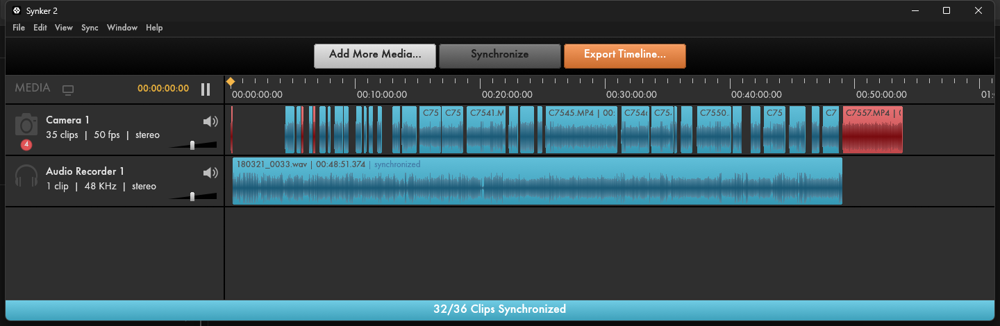
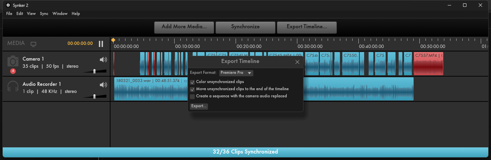

# Synker 2

**Audio-based clip synchronization for video editors.** Drop in your camera clips and your
separate audio recordings, press *Synchronize*, and Synker 2 lines everything up by its sound,
ready for your editing software.

Written in Rust. Windows 10/11 (64-bit) and macOS 11 or later (Apple Silicon and Intel).

## Download

Get the latest version from **[Releases](../../releases/latest)**:

- **Windows**: `Synker2-…-windows-x64.zip`. Unzip it and run `Synker2.exe`. No installation
  needed.
- **macOS**: `Synker2-…-macos-universal.zip`. Unzip it and move `Synker2.app` to
  *Applications*. The app is not notarized by Apple yet, so the first time macOS blocks it:
  right-click the app > *Open* > *Open*, or go to *System Settings > Privacy & Security* and
  click *Open Anyway*.

## Features

- **Waveform sync** of any number of cameras and audio recorders, one track per device.
- **Audio drift correction** for recorders whose clock runs slightly fast or slow.
- **Projects compatible with PluralEyes 4**: opens and saves `.p4p` project files.
- **Export to your editor**:
  - Adobe Premiere Pro (FCP 7 XML)
  - EDIUS
  - DaVinci Resolve (XML in the format Resolve reads correctly), unsynchronized clips get a
    *Not synced* marker
- **Live DaVinci Resolve link** (Resolve Studio):
  - *Send to running DaVinci Resolve*: builds the synchronized timeline directly in the open
    project, no XML step. Unsynchronized clips are coloured orange with a *Not synced* marker.
  - *Import Timeline from DaVinci Resolve*: reads the open timeline, syncs it and writes the
    result back as a **new** timeline (the original is never touched).
- **Place unsynced clips by recording time** (optional, off by default): clips the audio cannot
  sync are placed by their recording time, measured on the clips of the same camera that did
  sync, then searched again by audio in a narrow window. Clips placed by time alone are marked
  yellow, *Placed by clock*: check them.

## Requirements

- **FFmpeg** (`ffmpeg` and `ffprobe`), used to read the media.
  - Windows: install it (for example `winget install Gyan.FFmpeg`) so that it is in your `PATH`.
  - macOS: `brew install ffmpeg` ([Homebrew](https://brew.sh)); Synker 2 finds it there.
- For the live DaVinci Resolve features: **DaVinci Resolve Studio** running with external
  scripting enabled (*Preferences > System > General > External scripting using: Local*) and
  **Python 3** in your `PATH`.

## Status

Beta. Tested on real event shoots (Sony cameras + field recorder). Please report
problems in [Issues](../../issues), with the camera/recorder models and file formats.

---

PluralEyes is a trademark of its respective owner. Synker 2 is an independent project and is
not affiliated with or endorsed by it.
